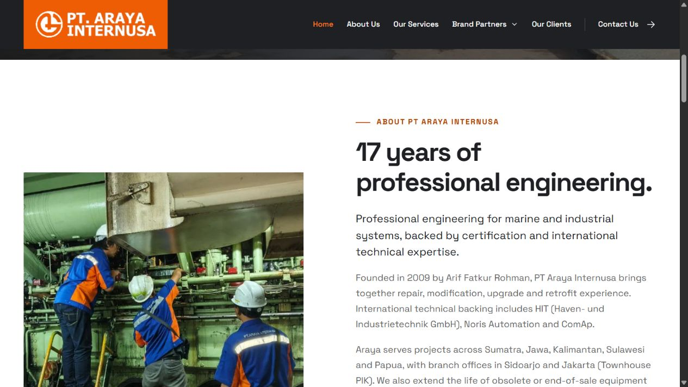

# Wording and relevance decisions — 14 October 2026

Owner requested a list for decision before further website copy changes. Review uses the current generated website/templates after the branch-office correction ff94e52. These are editorial concerns, not assertions that referenced services are false. No website content was changed for this review.

| ID | Existing text / area | Concern | Suggested decision |
| --- | --- | --- | --- |
| 1 | Partners who trust Araya — client section | Partners could mean distributors rather than customers | Change to Clients who trust Araya |
| 2 | Total solutions…speed, precision and professionalism — home services | Generic wording duplicates the concrete service scope | Replace with Supply, repair, upgrade and retrofit for marine and industrial systems |
| 3 | Professional experience. International technical backing. — About heading | Experience duration and backing mechanism are unclear in the headline, though the following copy names the organisations | Keep the positioning; consider Professional engineering since 2009 and identify HIT/Noris/ComAp support explicitly in the supporting text |
| 4 | Standardised working practices — About/inner pages | Does not tell a buyer which process or standard is meant | Specify actual procedures after owner input; keep certification claims omitted |
| 5 | Bring your equipment. Let’s define the scope. — brand enquiry | Could sound like the visitor must physically bring equipment | Change to Share your equipment details. Let’s define the scope. |
| 6 | Measurement expertise. Marine system thinking. — Noris | Marine system thinking is abstract | Change to Sensors, instruments and integrated marine systems |
| 7 | Engine supervision. Coordinated power. — ComAp | Coordinated power is vague compared with requested core applications | Change to Engine control, power management and load sharing |
| 8 | Hydrodynamic test facilities — Marine | Supported by the reference, but specialist laboratory work may distract from typical vessel services | Keep, move to specialist projects, or remove at owner direction |
| 9 | Bi-fuel & hydrogen / Fuel cells / CHP / Datacentres — ComAp | Manufacturer applications may be interpreted as established Araya services | Owner decides which are actual focus; keep other material clearly as manufacturer applications or collapse it into an additional-applications area |
| 10 | Energy market integration — ComAp | The existing description names Australia and Singapore, leaving Indonesian relevance unclear | Hide from the Indonesia-facing guide unless owner wants this manufacturer reference retained |
| 11 | PV, LV and PSV valves; EPROM/GAL/PAL/EPLD/PLCC and pin/layer limits — Automation | Dense, ambiguous or narrowly legacy-specific detail can distract buyers | Explain terms and retain only owner-confirmed useful limits; simplify the main description |
| 12 | Visit our current website; Design preview · Current website remains live — footer | Preview-only navigation/status distracts on a final company site | Keep during testing; remove for production release |

Technical references, original branding, professional/international positioning and the two confirmed branch offices remain as approved. Owner selections received and implemented as recorded below.

## Approved decisions and implementation

1. Changed client heading to Clients who trust Araya.
2. Replaced the generic total-solutions sentence with supply, repair, upgrade and retrofit scope.
3. Show company age: 17 years in 2026, calculated at build time from the founding year 2009. Updated About heading, hero annotation, footer and home metadata. Founding year remains in the history and structured data. Rebuild in a new year to refresh the static age.
4. Initially retained working-practices wording at the owner's request. A subsequent instruction superseded this: remove standardised/standardized positioning and use certified wording. General certification wording is owner-approved; no named certification, issuer, logo or accreditation was invented.
5. Changed brand enquiry heading to Share your equipment details.
6. Noris heading now says Sensors, instruments & integrated marine systems.
7. ComAp heading now lists Engine control, Power management and Load sharing.
8. Removed hydrodynamic test facilities completely from the generated Marine service list and finder. Marine now has ten scopes.
9. Retained manufacturer applications including hydrogen, fuel cells, CHP and datacentres.
10. Hid energy-market integration from the generated ComAp guide. Eighteen applications remain. Manufacturer research data is retained in source, filtered before rendering.
11. Simplified dense valve/legacy-IC/layer/pin wording to automation systems and electronic control-board repair.
12. Removed the visible preview-status footer and old-website link from every page. The test site retains noindex metadata; production hosting remains a separate deployment.

Checks: six-page artifact checker, three experience regression checks and whitespace check passed. ComAp has 24 contextual enquiry links (18 applications plus six product families), Noris eight. About heading rendered without horizontal overflow in the desktop browser. Current certification copy supersedes earlier working-practices screenshots and notes.

Publication verification pending for this content revision.

