# Content, flow, design system and animation audit

13 October 2026. Local preview commit: 2503995aba9878e2a84658a5597267b27c629035.

## Scope and verdict

Inspected all six local pages, their content structure, service/application discovery, diagram viewer, enquiry paths and motion. This is the local revision, not a fresh production or published Pages audit. No website implementation, commit or deployment was performed.

The visual identity is coherent and appropriate for an engineering company. Application explanations, selection requirements and manufacturer imagery are the strongest content. The main weakness is navigation and enquiry continuity within the long brand guides. Preserve the orange/charcoal identity, original logo and detailed guides; improve orientation and contextual actions.

## Walkthrough and screenshots

1. **Arrive and understand Araya — healthy.** The homepage explains marine, industrial and automation engineering across Indonesia, followed by concrete supply/repair/retrofit scope and a clear project CTA. Real photography and project coverage support the identity. Broad phrases such as “Total solutions” add less information than the specific scope descriptions.

   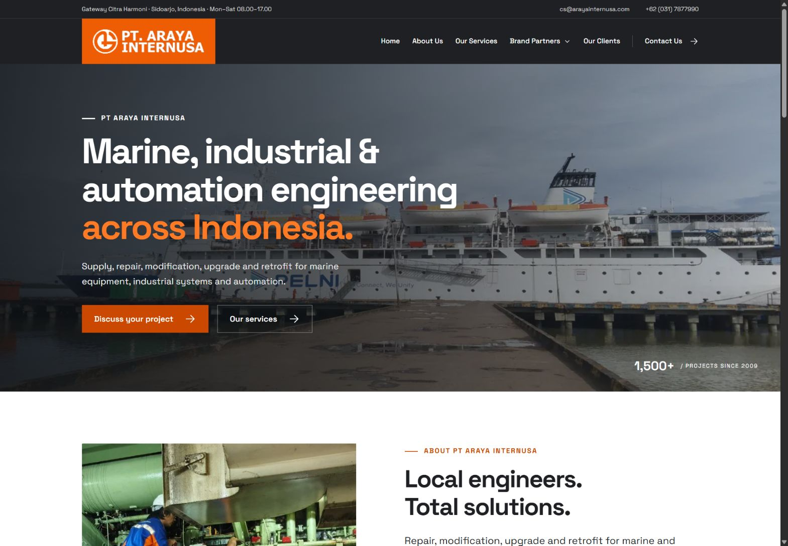

2. **Choose a service — healthy.** Three service cards and twelve common-request links help visitors find relevant work. Fire alarm & monitoring successfully landed on the Marine scope. Industrial and Automation share a clear hierarchy. Their category overlap is understandable from subtitles and related links. A local scope index would help visitors entering a service page directly.

   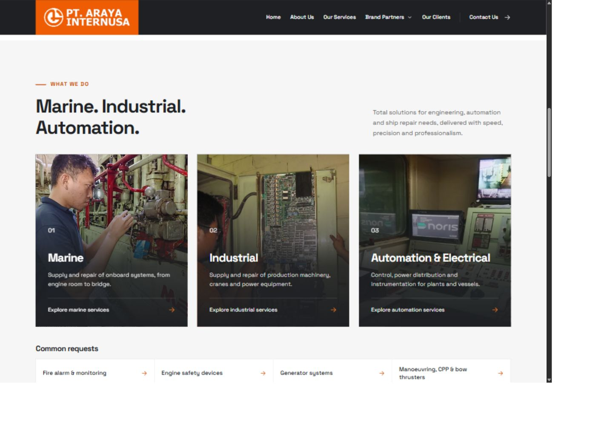
   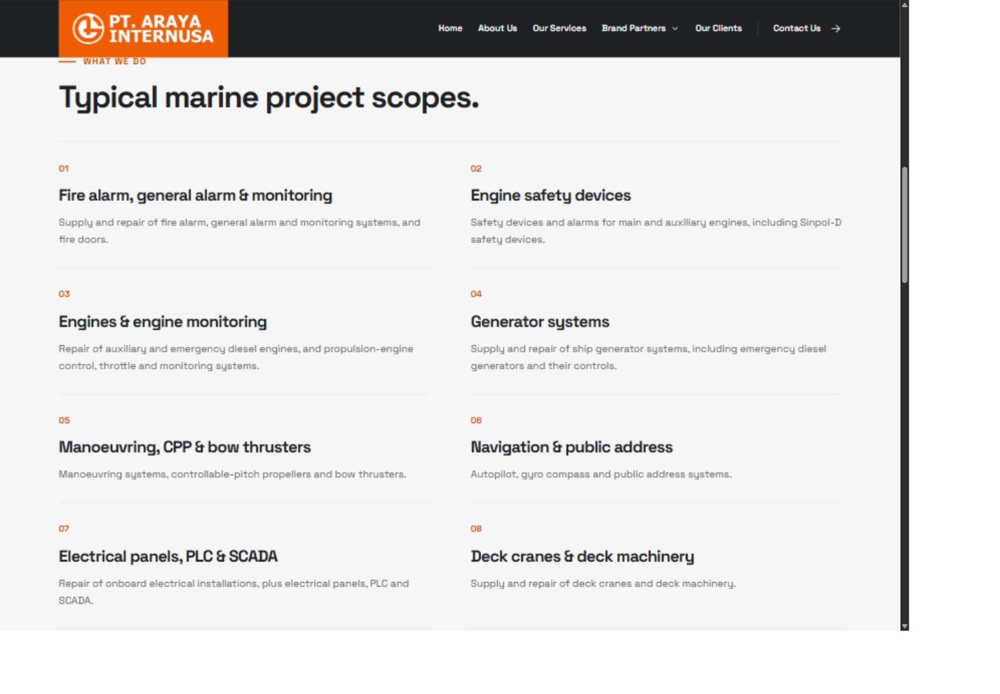

3. **Understand a brand/application — strong content; orientation needs work.** ComAp explains the system, control functions, controller families and project inputs across nineteen applications. Noris covers eight instrument/sensor/system families. Images and selection details support the product names. Both have working entry indexes, but these disappear while reading.

   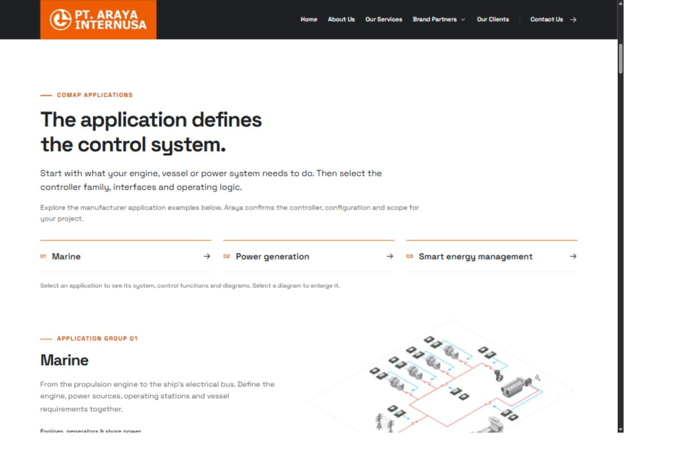
   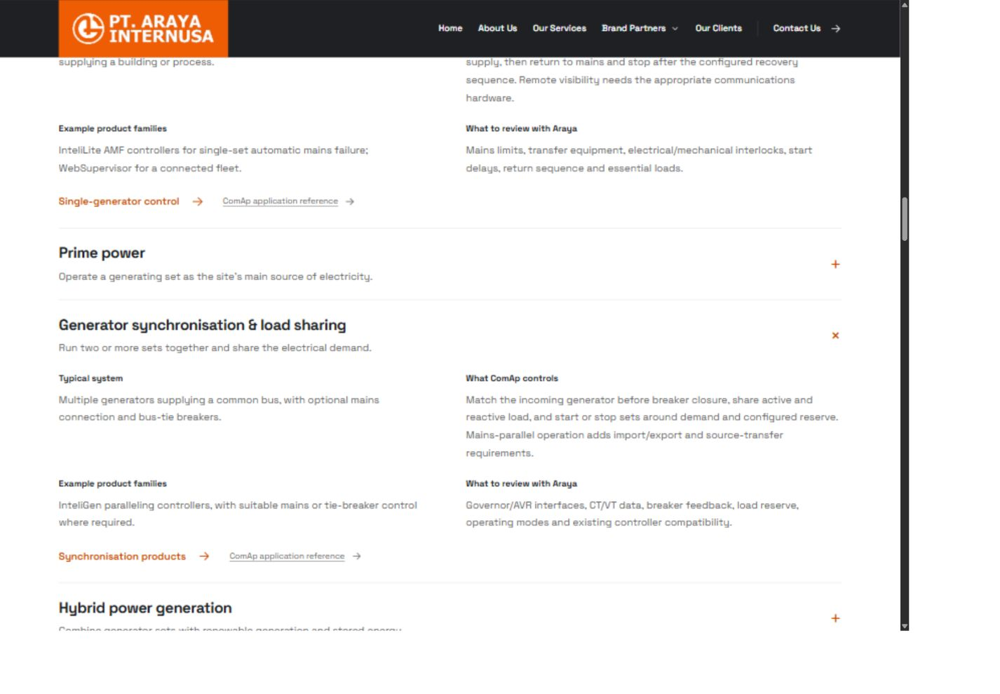
   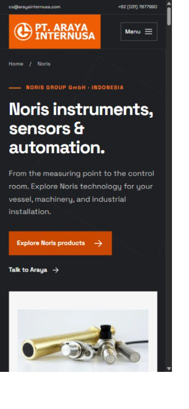

4. **Inspect diagrams and mobile navigation — healthy.** ComAp diagram enlargement, 150% zoom, Escape dismissal and focus return worked. The mobile menu and Brand Partners dropdown work. NORINET explains onboard collection, the interface, cloud telemetry and remote service, with the original system diagram. Its internal heading spacing needs tightening.

   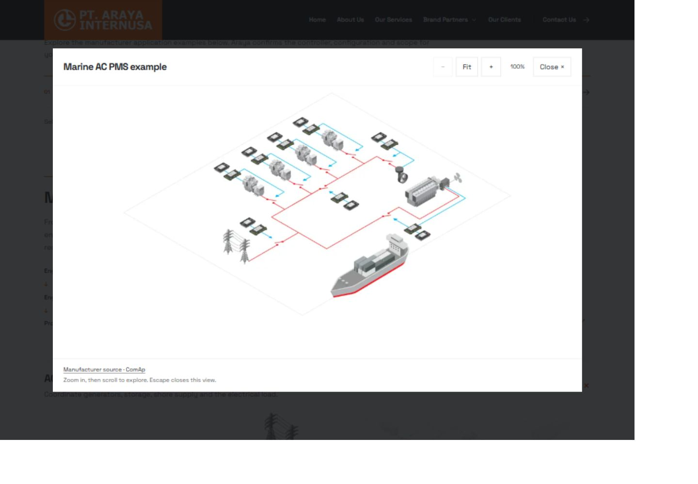
   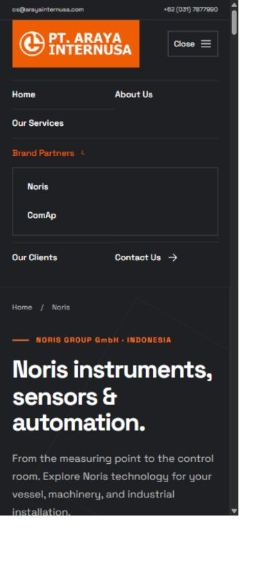
   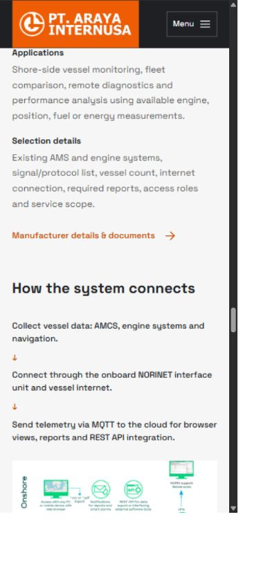

5. **Build confidence and enquire — functional; retain context better.** Client logos, coverage, contact methods and equipment checklists are useful. The logo Pause button worked. However, Contact Us on Marine navigates to the homepage, while brand product entries offer manufacturer links without an adjacent Araya enquiry. Brand-specific WhatsApp labels lead to a bare phone URL without the brand in a draft message.

   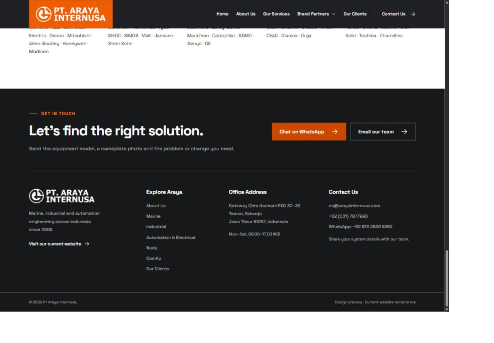
   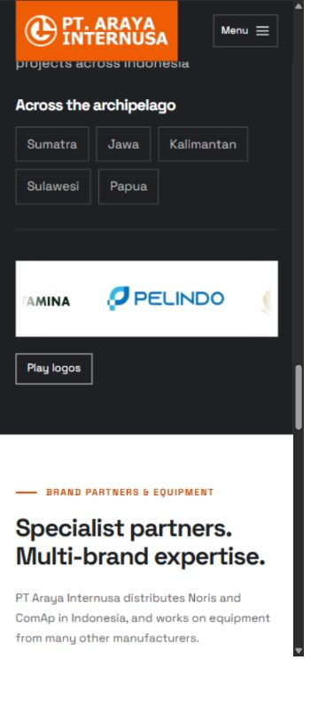

## Prioritised findings

### Medium: persistent orientation in the long guides

At 390 × 844 CSS pixels, ComAp measures approximately **21,074px** tall with three applications open by default; Noris measures **16,708px**. Enquiry sections start at approximately y=17,031 and y=12,771 respectively. Hero and section links already provide shortcuts, so visitors do not have to scroll the whole distance. The problem is recovering those shortcuts deep inside the guide. The global header stays sticky; the brand section navigation is static and has no active-section cue.

Keep the long guides. Add a compact “On this page” control that remains available while reading, collapses on mobile and includes Enquire. Avoid two tall sticky bars. Add “Back to applications/products” at useful boundaries. Consider opening only the selected application rather than three unrelated default examples, preserving direct-link and keyboard behavior.

Evidence: steps 3–4; mobile-metrics.json and audit-checks.json in the screenshot folder. Source: public/assets/site.css:35; tools/brand_pages.py:41 and :69.

### Medium: contextual Araya enquiries

Product rows offer “Manufacturer details & documents” without a local enquiry action. Application explanations offer a product link and manufacturer reference. Retain those references and add “Discuss this application” or “Enquire about this product” with a draft message naming the application or product. Do not send automatically.

Change the shared Contact Us destination to the current page's contact/enquiry anchor. Preserve brand context in brand WhatsApp buttons, which currently use https://wa.me/6281326396262 without a message. Service hero buttons already provide a service-specific draft and are a useful pattern.

Evidence: steps 3 and 5; tools/brand_pages.py:41, :58 and :77; tools/build.py:91. This is an inspection-based recommendation, not a measured conversion loss.

### Medium: small-text contrast

- White on the About badge orange (#ee5c03) is **3.40:1**. The affected text is the small caption, not the large year.
- Product-link orange (#cb4800) on muted grey (#f6f6f6) is **4.35:1**. Browser inspection confirmed a 14px, weight-600 link on mobile, below the usual 4.5:1 normal-text threshold.
- The same orange on white is **4.70:1**. Light orange (#ff7a24) on charcoal (#1e2023) is **6.27:1**. Preserve separate colour roles; use a darker text accent on muted surfaces.

Ratios were calculated from CSS colours using relative luminance. Sources: public/assets/site.css:6, :14–16 and :28. Product-link colours were checked in the current browser run. The badge finding was confirmed from source; its screenshot belongs to the separate UI consistency review. This is not a full accessibility conformance assessment.

### Medium: logo animation fallback

The current strip loops every 38 seconds. Runtime inspection showed the transform advancing, then animation-play-state paused and aria-pressed=true after Pause logos was clicked. The ordinary JavaScript path works.

Source inspection shows unconditional animation while the pause button is hidden without the js class and depends on a script listener. Without JavaScript, touch users can receive continuous motion without an operable pause. Start with a static wrapped list, hide the duplicate track, and enable animation only after the pause handler is ready. Merely turning off animation with overflow still hidden would leave some logos inaccessible.

Consider the static list on mobile too: only a small subset is visible in the strip, and pausing does not reveal the others. This is optional presentation refinement; the JavaScript fallback is the concrete defect.

Evidence: step 5; public/assets/site.css:62–73 and the final pause listener in site.js. No-JavaScript and reduced-motion variants were inspected in source, not emulated in this run.

### Low: formalise the existing design rules

The shared header, footer, cards and portfolio components are consistent. Colours and container width use variables, but type sizes, spacing, borders and motion durations are mostly literal component values, spread across repeated responsive overrides. Consolidate role-based tokens without changing the look.

Include h4 in the heading rules: NORINET's 24px heading currently inherits a 40.8px line height and browser margins of 31.92px. Unify FAQ leading triangles and application trailing plus indicators, including focus/open states. Keep different text sizes where the content warrants them. Define a readable secondary-text minimum: utility labels can be 10px and hero annotations 9px. Add a current-page cue; ComAp had no aria-current element.

## Content assessment

| Page | Strength | Refinement within approved scope |
| --- | --- | --- |
| Home | Clear location and engineering scope; real photos; separate services, clients and partners | Reduce repeated broad phrases and keep concrete scope wording prominent |
| Marine | Eleven explicit scopes and equipment checklist | Add quick scope navigation; expand specialist terms where helpful |
| Industrial | Eight scopes distinguish machinery and power work | Make equipment examples easy to scan and retain enquiry context |
| Automation & Electrical | Twelve scopes covering control, power and instrumentation | Add a compact scope index without repeating the full list in introductions |
| Noris | Eight families, images, selection guidance and NORINET flow | Offer quick entry by need: instrument replacement, onboard monitoring, remote monitoring |
| ComAp | Nineteen applications explain systems rather than only modules | Prioritise common enquiry paths and add local actions while retaining the full guide |

Keep the “Typical system / What ComAp controls / Example families / What to review” pattern. NORINET usefully distinguishes onboard systems from shore access. Keep manufacturer-example captions and the distinction between featured distributors and the wider equipment list.

Abbreviations such as AMS, AVR, CT/VT, MCC and PFC are efficient for engineers but harder for purchasing staff. Add first-use expansions or a small glossary. Do not invent capabilities, authorisations, availability or outcomes to strengthen copy. The reference-only content rule remains. This audit assesses clarity and presentation, not fresh verification of manufacturer specifications or company claims.

## Existing design system to preserve

| Role | Current approach |
| --- | --- |
| Identity | Orange, charcoal, white; original logo; square corners |
| Typeface | Space Grotesk, 17px desktop / 16px mobile body |
| Layout | Centred 1240px maximum container; generous sections; 20px mobile side space |
| Hierarchy | Shared section headings around 49px wide / 32px mobile |
| Primary action | Darker orange, white text; roughly 56px desktop / 52px mobile minimum height |
| Images | Engineering photos fill frames; product/diagram images preserve the complete object |
| Components | Header/footer, service cards, scope rows, product finder/rows, enquiry lists, viewer |
| Intentional variants | Photo homepage hero, text service hero and split brand hero fit their different content |

The site does not need a new visual identity. Improve reading, orientation and shared rules.

## Animation assessment

| Motion | Behavior and assessment |
| --- | --- |
| Section navigation | Smooth CSS scrolling; reduced motion switches to auto. Appropriate, though long jumps make local navigation valuable. |
| Service-image hover | Scale 1.04 over 0.5s. Restrained; inspected in CSS, not pointer-tested here. |
| Button hover | Background transition 0.2s. Appropriate feedback. |
| Partner dropdown | Chevron rotates over 0.15s. Clear open-state cue. |
| Application expansion | Native disclosure and plus-to-x state. No elaborate opening effect needed. |
| Diagram zoom | Immediate stepped resizing and Fit; 150%, Escape and focus return tested. |
| Client strip | 38s linear loop; manual pause works. Improve fallback and consider static mobile layout. |
| Reduced motion | Removes transitions/smooth scrolling; wraps static non-duplicate logos. Sensible source rules; runtime emulation not performed. |

No additional hero carousel, scroll reveals or automatic motion is needed for this engineering site.

## Verification and limits

- Existing six-page checker passed local assets/fragments, metadata, alt text, fonts, publication exclusions and no-PR workflow checks. JavaScript syntax check passed.
- Fresh browser evidence covers desktop service/brand/contact flows and mobile menu, Noris, ComAp, Industrial, Automation and homepage clients. Final measurements: 1440 × 1000 and 390 × 844 CSS pixels. Initial home capture was 1584 × 1100 before browser zoom settled.
- No horizontal overflow in the measured mobile Noris, ComAp, Industrial and Automation views. This was not a complete breakpoint sweep of every route.
- Logo movement/Pause, ComAp disclosure, diagram zoom and Escape/focus return worked. The tab log contained no captured warning/error entries.
- Saved screenshots were reopened and inspected. Temporary blank or incorrectly framed captures were replaced.
- No messages were sent. No fresh manufacturer fact-check, screen-reader testing, physical-device test, full keyboard sweep, no-JavaScript emulation, Lighthouse run or ranking measurement.
- Conclusions are expert inspection findings, not conversion analytics or user-testing results.

## Implementation order

1. Fix normal-text contrast and progressively enhance the client animation.
2. Add contextual enquiries and keep Contact Us on the current page.
3. Add compact persistent brand navigation and current-section feedback.
4. Consolidate design tokens, h4 spacing and disclosure indicators while preserving the style.
5. Tighten repeated wording and expand abbreviations within the existing sourced content.

Status: documented review only; no site changes or publication.
