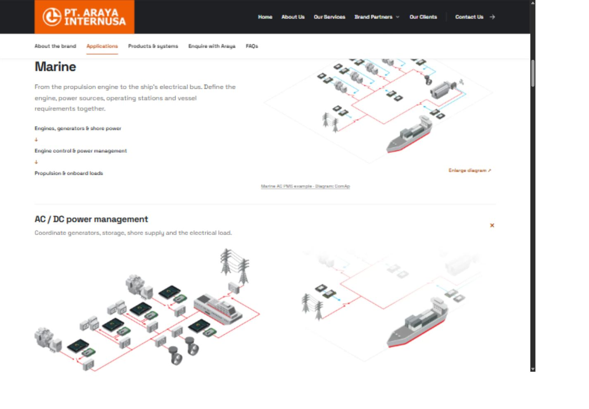
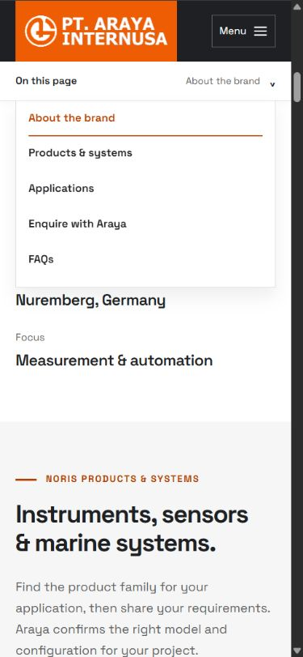
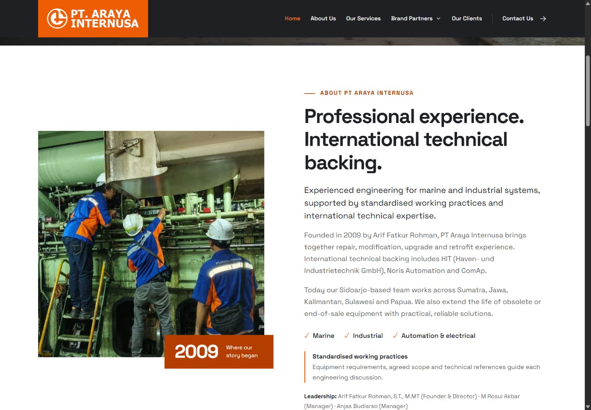
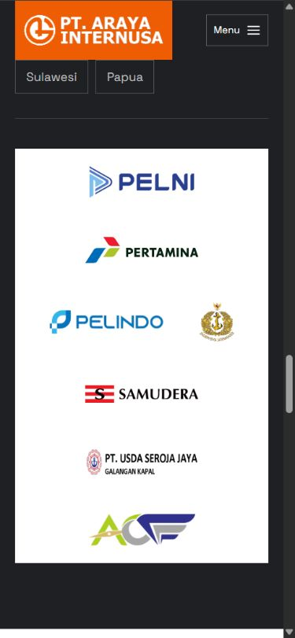
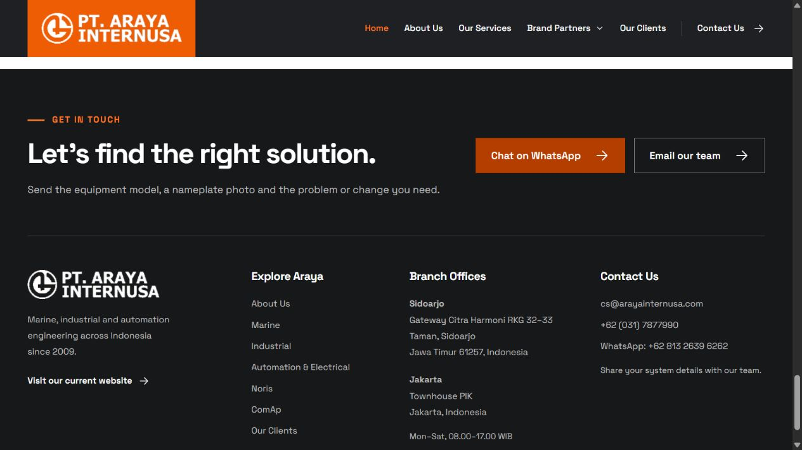

# Experience improvements — 14 October 2026

Implemented from the owner's approval of the [experience audit](EXPERIENCE-AUDIT-2026-10-13.md). The owner also requested extra animation and professional positioning instead of local-engineer wording.

## Company voice and sources

- Replaced “Local engineers / Total solutions”, Indonesian-team wording and the foreign-versus-local founding narrative with professional experience, standardised working practices and international technical backing.
- Retained founding year, founder, service scope, leadership, owner-supplied project total and geographic coverage. Office location remains a practical contact fact.
- The live Araya homepage Experts block was retrieved on 13 October by HTTPS and explicitly names HIT (Haven- und Industrietechnik GmbH), Noris Automation and ComAp as technical backup. This supports the About paragraph's named international backing. The reference mission supports professional service wording. See [reference homepage](https://arayainternusa.co.id/araya/).
- Standardised working practices is the owner's updated positioning. The copy describes equipment requirements, agreed scope and technical references; it does not assert a specific certification or accreditation.
- The owner reported certifications and then instructed **skip for now** on 14 October. No credential names, logos or certification claims were added. Preserve this decision until exact details are provided.
- Added repository AGENTS.md so future edits preserve this voice. Technical local/remote terminology remains where it accurately describes equipment operation.

## Navigation and enquiries

- Five inner pages share a persistent page navigator. Desktop shows section links and an active section cue; mobile uses a compact On this page button and an overlaid list that leaves content in place.
- The mobile navigator supports Escape and sends keyboard focus to the selected destination. Header/index offsets account for the actual header height. Anchor selection tolerance accounts for the utility row compacting during scrolling.
- Marine, Industrial and Automation include an expandable scope finder. Existing common-request deep links remain.
- Contact Us stays on the current page. Shared contact WhatsApp drafts retain the current service or brand.
- Eight Noris product areas, six ComAp product areas and nineteen ComAp applications now have contextual enquiry actions. Messages are drafts addressed to +62 81326396262 and name the relevant subject; no message is automatically sent.
- Product/application entries include return links to the corresponding index. ComAp applications start collapsed; direct application hashes still open the requested explanation.

## Design and motion

- Preserved artwork, colours, photos, square corners, main layouts and long brand guides.
- Darkened the readable text accent to #b43e00 for muted surfaces and the About badge caption. Button hover uses #923300. The orange logo identity remains #ee5c03.
- Unified FAQ/application expand indicators and reset NORINET h4 spacing. Enlarged tiny mobile utility/annotation labels. Added shared section, caption and motion tokens as a foundation for maintenance; this is not a complete stylesheet refactor.
- Added gentle, one-time section/card entrances, directional link-arrow feedback, disclosure opening and diagram-viewer entrance effects. Content is visible by default. Reduced-motion preferences suppress effects; changing that preference cancels active scripted entrance animations.
- Client logos are a static wrapped list by default, with the duplicate hidden. Desktop motion is enabled only after the Pause handler is bound and only when reduced motion is not requested. Mobile always shows the readable seven-client grid. This corrects the no-JavaScript pause dependency identified in the audit.

## Verification

- Existing checker passed all six pages: local assets/fragments, metadata, alt text, fonts, publication restrictions and workflow policy.
- Three regression tests passed: current-page contact, all 33 contextual product/application enquiries, and company positioning. Tests were first run against the old artifact and failed for the intended missing behavior.
- JavaScript syntax and git whitespace checks passed.
- Independent read-only code review found no actionable regressions. A subsequent desktop visual check caught an active-section offset issue, which was fixed and verified at Applications. Mobile selection/focus and the overlay were also checked after that review.
- Browser checks used desktop 1440 × 1000 and mobile 390 × 844; intermediate responsive captures also used 430 × 928. Service mobile checks: Marine 11 scopes, Industrial 8, Automation 12; no horizontal overflow. Noris mobile has eight contextual enquiries and no overflow.
- ComAp direct #parallel-generation opens its explanation and provides the correct draft. FAQ opens and its plus rotates to the expanded state. Mobile index selections close the list and focus the destination.
- Native pointer testing showed opening the mobile index leaves scroll position unchanged. Some automation locator clicks scrolled the sticky control into view; this was distinguished from direct pointer behavior.
- Desktop logos animate and Pause sets animation-play-state to paused with aria-pressed=true. Mobile has no logo animation, hides the duplicate track and loads all seven originals.
- Automation scope finder and PLC deep link worked. Its Contact Us remained on /automation/#contact, with an Automation & Electrical draft.
- No captured warning/error entries in the verification tab. No messages were sent. Reduced motion and no-JavaScript fallbacks were checked in source; no full screen-reader assessment or new Lighthouse/ranking measurement was performed.

## Accepted evidence

Additional mobile positioning, FAQ evidence and service-layout measurements are in [the evidence folder](reviews/improvements-2026-10-14/).

## Published release

Website-content commit: [921909b](https://github.com/hakiimm8/arayaweb/commit/921909bf355c1ec6454f63127ea26a12e378daa1). [GitHub Pages deployment](https://github.com/hakiimm8/arayaweb/actions/runs/38473028516) succeeded on 14 October 2026. All six published HTML pages and both shared CSS/JS assets returned HTTP 200 and matched the verified local files byte for byte after line-ending normalisation. The push also included the previously local reference-only content and reproducible cache-hash fixes.

The hosted preview could not be reopened in the in-app browser because the new webview failed to attach twice. Published verification therefore confirms identical deployed files; visual/interaction evidence is from the local build. No fresh hosted-browser visual claim is made. The user's existing local browser tab was preserved.

The full improvement, source and prior review documentation is committed to main. Only public is deployed. Production WordPress is unchanged.

## Branch office correction

Owner correction: removed Sidoarjo-based team wording; Sidoarjo and Jakarta (Townhouse PIK) are branch offices. Shared contact details, About wording and structured locations were updated. Release [ff94e52](https://github.com/hakiimm8/arayaweb/commit/ff94e522261fed5e63a1df2cd14d43ab4f5fd064) deployed successfully in [Pages run 38473939229](https://github.com/hakiimm8/arayaweb/actions/runs/38473939229); published homepage returns 200 and contains the new branch details. Six-page static/experience checks and both structured locations passed.

