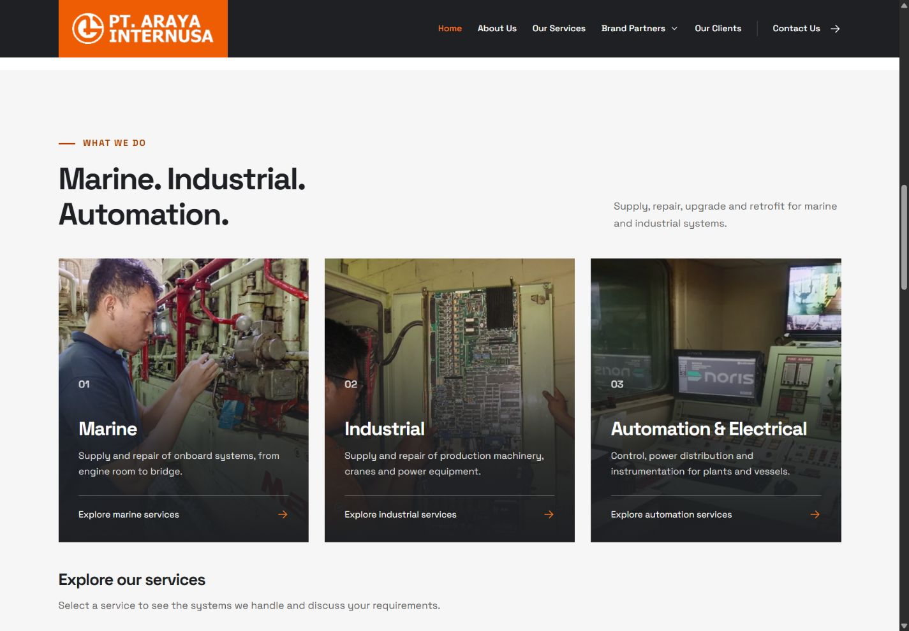
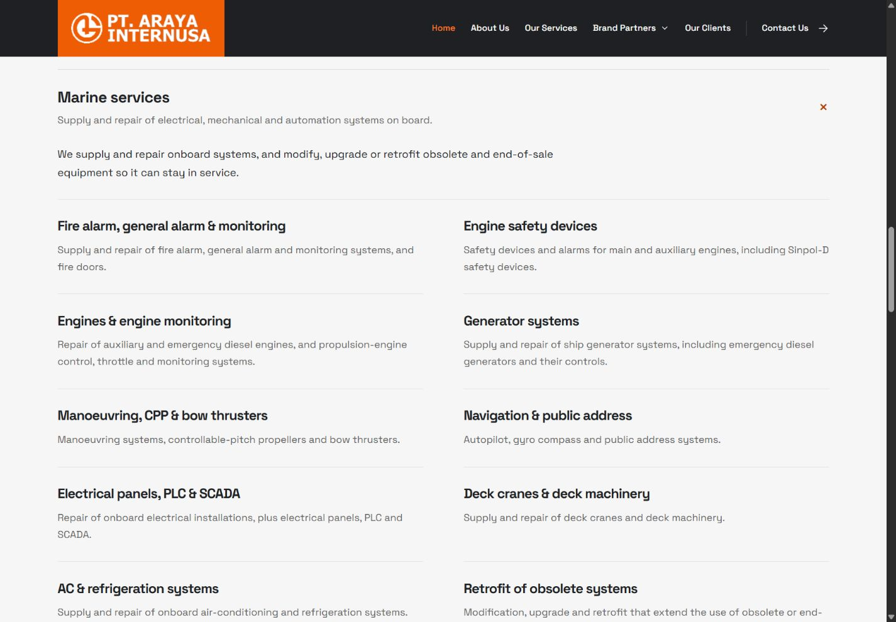
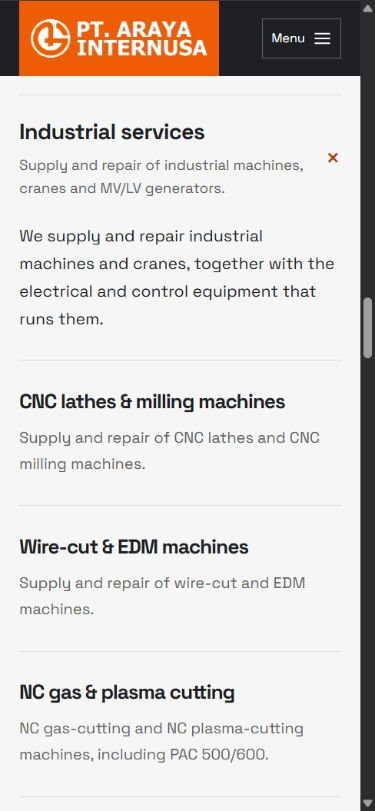
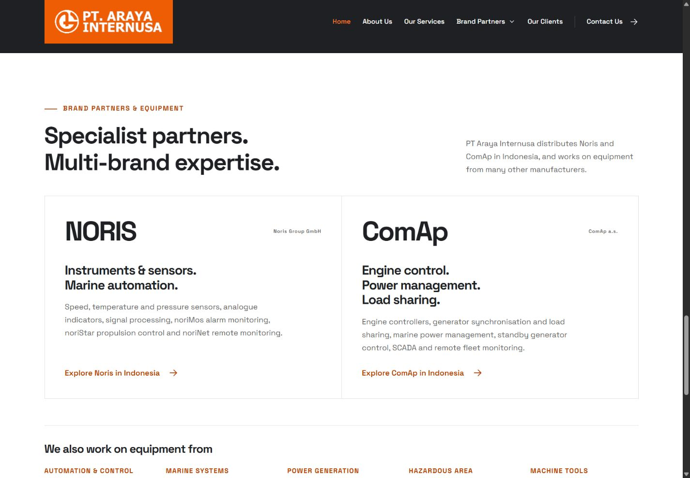

# Single landing page, partner names and automatic years

14 October 2026. Implements the owner's three requests: automatic yearly age updates, a single Araya landing page with separate Noris/ComAp pages, and consistent manufacturer company labels.

## Site structure

- Main landing page contains About, Services, Clients, Brand Partners and Contact.
- Removed the Common requests grid. The three existing photo cards now link to Marine, Industrial and Automation details on the same page.
- Native service disclosures contain the approved scope descriptions (10 Marine, 8 Industrial, 12 Automation), equipment lists, contextual enquiry briefs and six service-specific Noris/ComAp links/descriptions. Content can be expanded without JavaScript.
- Dedicated Noris and ComAp guides remain with their application explanations, images, diagrams, page navigation and enquiries. Cross-links from those guides return to the relevant homepage service section.
- Footer service links point to the homepage sections.
- Existing /marine/, /industrial/ and /automation/ URLs are compatibility documents, not additional service content pages. Their script redirects old overview, equipment, contact and scope bookmarks to the matching homepage anchor. A manual landing-page link remains if JavaScript is unavailable. These are client-side redirects, not HTTP 301 responses.
- Sitemap lists three content routes: homepage, Noris and ComAp. Service structured data now belongs to the homepage and uses its section URLs.
- Scope IDs are prefixed by service to avoid duplicate anchors such as marine-cranes and industrial-cranes.

## Partner labels

Homepage company labels now use the shared legal_name fields: Noris Group GmbH and ComAp a.s. The corresponding page eyebrow labels match. The brand wordmarks remain NORIS and ComAp. Small legal-name labels are 12px for readability. The technical-backing paragraph retains Noris Automation because that is the entity named in the supplied reference.

## Automatic years

The founding year remains 2009. public/assets/company-date.js calculates the year using Asia/Jakarta and writes company age to all three homepage age fields and the shared footer on brand pages. Copyright year is updated on all content pages.

- Page loads calculate current age immediately: 17 in 2026, 18 in 2027 and 19 in 2028.
- A timer updates tabs held open through New Year. Long timer delays are capped safely and rescheduled.
- pageshow and visibilitychange refresh restored or sleeping tabs.
- Numeric phrases are hidden until the date updater succeeds. Without JavaScript, the page shows readable age-free copy, rather than a stale numeric claim. The generated numbers serve only as initial data before the script writes the current values.
- Metadata and company schema descriptions use timeless wording; foundingDate remains 2009. The build also calculates its initial year in Jakarta time.
- No annual manual text edit, scheduled task or deployment is needed for the visible age to advance in ordinary browsers.

## Verification

- python tools/check.py passed all six HTML documents: three content routes plus three compatibility redirects, local assets/fragments, metadata, images/font and workflow policy.
- Four experience regression checks passed, including removal of Common requests, internal service links, three sitemap content routes and existing contextual enquiries/company positioning.
- node tools/test_company_dates.cjs passed year calculations, Jakarta midnight boundary, successive years and leap year. The actual updater was run with a controlled clock: 2026-12-31 16:59:59.999 UTC shows 17; after 17:00 UTC it shows 18. Tests also cover all fields, copyright, tab resume and timer limits.
- JavaScript syntax and whitespace checks passed.
- Browser checks at 1440 × 1000 and 390 × 844: service cards open the homepage disclosure, Marine has ten scopes, Industrial details reflow without horizontal overflow, and dedicated ComAp still opens normally.
- Old Marine #alarms, Industrial #cranes and Automation #equipment links redirected to matching homepage anchors and opened their containing disclosures. Automation #plc was also checked.
- Browser confirmed company labels, dates-ready class, three age fields showing 17, six related brand links and no captured warning/error log entries.
- Independent code review found two content gaps, both fixed: restored service-specific partner technology and aligned the Noris company label. A follow-up review found no new actionable issue and confirmed the age-free fallback.
- No enquiry was sent. No full screen-reader evaluation or new Lighthouse/SEO ranking measurement was performed.

## Evidence

Deployment verification pending. Only public is published to GitHub Pages; production WordPress remains a separate deployment.
