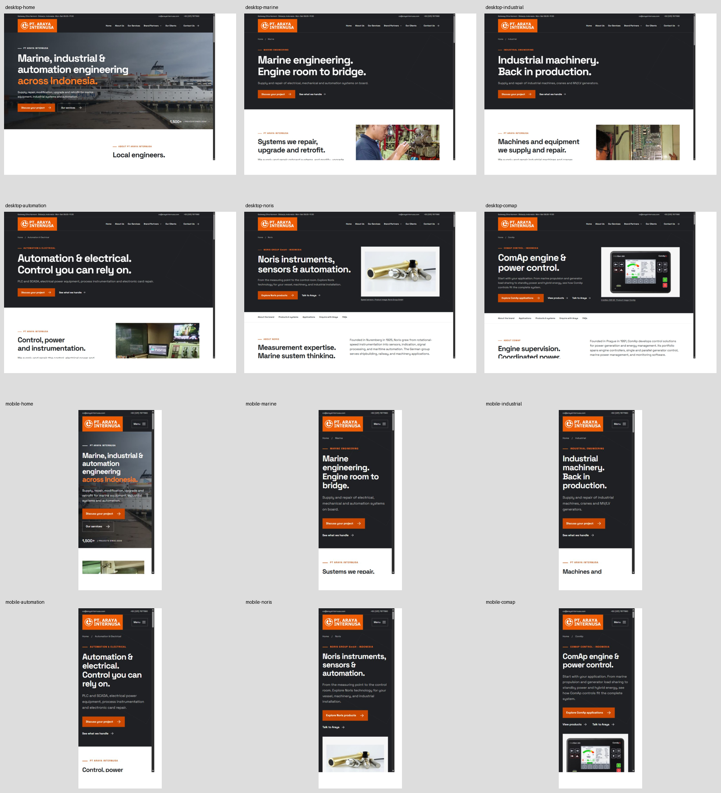
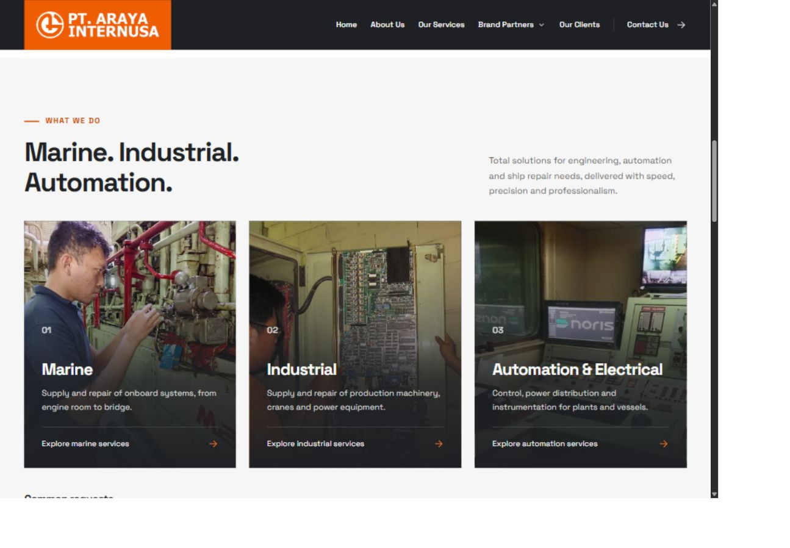
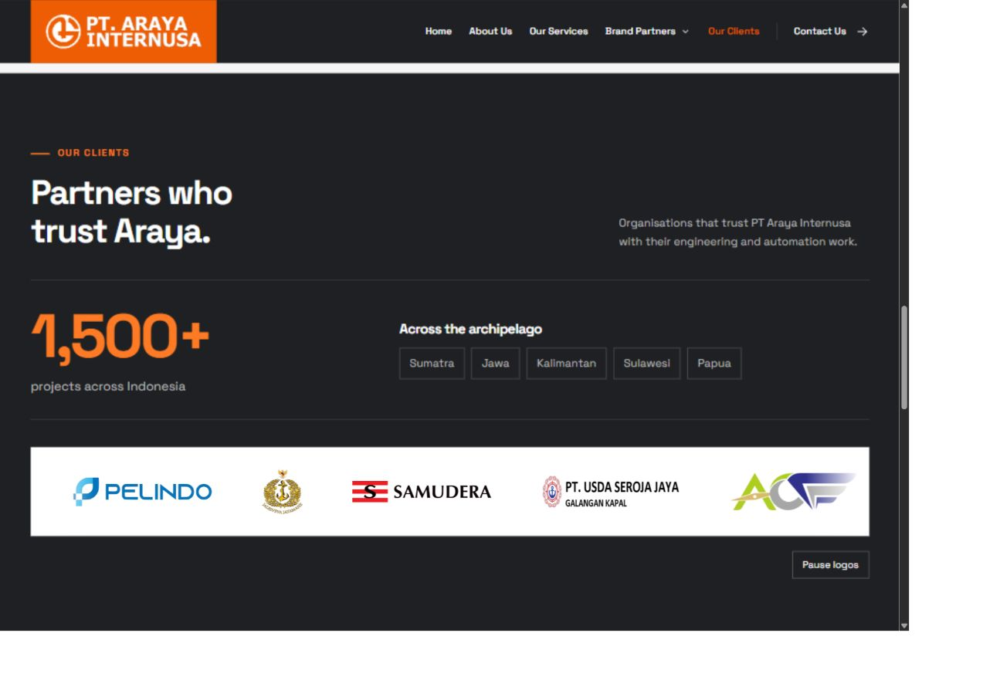
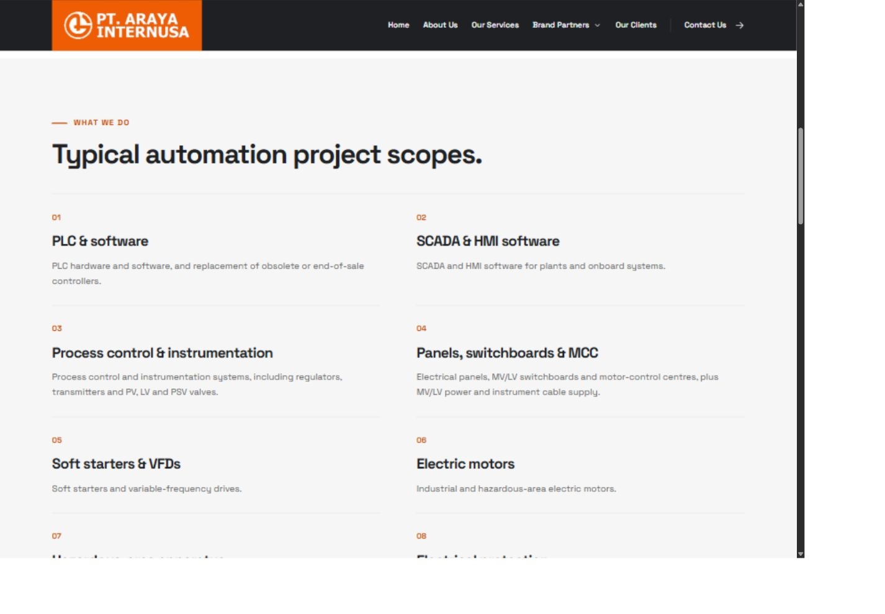

# Review of the owner's changes — 13 October 2026

## Findings

### P2 — Client logos animate without an available pause control when JavaScript is disabled

`public/assets/site.css:65` starts the 38-second infinite animation without requiring JavaScript. At line 72, the Pause button is hidden by default and only shown under `.js`. A touch visitor with JavaScript disabled and no reduced-motion preference therefore sees continuously moving logos without a usable pause control. Hover is not a reliable touch alternative. This is a motion/accessibility regression introduced by the new strip.

Recommendation: show a static, wrapped client list by default, hide its duplicate track, and enable the animation only when the pause handler has been attached successfully. Keep the existing reduced-motion rule. Merely stopping animation while retaining overflow clipping would leave some clients inaccessible.

Evidence: source/CSS inspection and independent code review. With JavaScript enabled, the browser check confirmed that both tracks run, all fourteen images load, and Pause changes the animation state to `paused`. Disabling JavaScript was not dynamically retested in this run.

### Release status — Two reviewed commits are not on GitHub yet

Local `main` is `2503995aba9878e2a84658a5597267b27c629035`. GitHub's main branch is still `09edf8b1849aee7de604a0a618c87b49650b08b7`, confirmed through the GitHub API. The local-only commits are:

- `ccef6ce`: normalise asset hash line endings.
- `2503995`: restrict Araya claims to the reference website/company profile.

The latest recorded successful Pages run is [37896508281](https://github.com/hakiimm8/arayaweb/actions/runs/37896508281), for `09edf8b`. Its website content corresponds to `541345c`. The published homepage still includes the guarantee/HIT/one-team strip and older copy; the current local page removes that strip and uses the revised reference-only wording. This is a publishing status observation, not a code defect.

### P3 — The current-release documentation mixes published and local content

`docs/PROGRESS.md` identifies the published website-content release as `541345c`, but its current page inventory lists the local eleven-scope Marine page. That published version still has twelve Marine scopes. Record the reviewed local head and published head separately until deployment, then update the release table after verifying publication. `docs/README.md` also still calls this a five-page preview although there are six routes.

## Scope and method

- Compared `0e1cb57` (the end of the NORINET work) with local `2503995`; working tree was clean before review.
- Reviewed the content restructure, company/client data, new Automation page, brand copy changes, logo preparation, responsive assets, marquee and build hash handling.
- Applied the latest reference-only content rule in CONTENT-SOURCES.md. Earlier removed service claims, language choices and per-project case studies were not treated as missing requirements.
- Used the Codex in-app browser against the current local static artifact and inspected the published homepage separately.
- Checked all six routes at actual CSS viewport sizes **1440×1000** and **390×844**. Earlier exploratory desktop captures use 1309×909; the final route captures use 1440×1000. Browser sizing was restored after review.
- Independent static/code review performed with no source edits or additional delegation.

## Experience assessment

The original orange/charcoal/white style is consistent across all routes. The service split and client section make Araya's capabilities and customer context easier to understand. Noris and ComAp remain distinct distribution partner pages, alongside broader equipment experience. The WhatsApp-first action gives visitors a clearer next step.

The Noris and ComAp titles/descriptions still target distributor searches in Indonesia. A single H1, canonical URL, description and intentional `noindex, nofollow` are present on every page. The noindex setting is appropriate for this preview. Production launch still requires production URLs and indexing settings; no search-ranking improvement is established by this review.

Small utility/caption text and orange-on-light contrast remain design opportunities already deferred in the earlier audit. They are not new regressions from this change range. The long ComAp catalogue still makes its application index important; the index and diagrams remain usable in the checked flow.

## Checked flow and screenshots

1. **Homepage → services:** reviewed the desktop and mobile hero, original logo identity and WhatsApp-first actions; the three service cards and common requests remain available.
2. **Services → Automation scopes:** the scope link reached the section below the sticky header; twelve scopes are present, including separate PLC and SCADA/HMI entries.
3. **Homepage → clients:** all seven client identities load in both animation tracks. Pause worked with JavaScript enabled.
4. **Mobile menu → Brand Partners → Noris:** the individual partner links are present and selecting Noris closes the mobile menu.
5. **Noris → noriNet → enlarged diagram:** both images loaded, the diagram identified Noris as its source, and Escape closed the viewer and returned focus to its trigger.
6. **ComAp → marine diagram:** the viewer opened with the correct caption, asset and ComAp source credit; Close worked.
7. **All routes:** inspected saved desktop/mobile captures. No horizontal page overflow was detected; initial main images loaded and each route retained one H1. All checked WhatsApp destinations use the owner's number. No enquiry was sent.

Full screenshot set and browser JSON are retained locally in `arayaweb/design/review-2026-10-13/`. The screenshots above are copies of accepted evidence from this run, outside the deployed `public/` directory.

## Verification

| Check | Result |
| --- | --- |
| `python tools/build.py` | Passed; six pages and sitemap built. Rebuild left the source/generated working tree clean before review documentation was written. |
| `python tools/check.py` | Passed: six pages, local links/fragments, metadata, alt text, font, publication exclusions and no-PR workflow. |
| `node --check public/assets/site.js` | Passed. |
| Desktop/mobile route checks | All six routes passed one-H1, initial image loading and horizontal-overflow checks. |
| Browser warning/error log | No warnings/errors returned for the checked tab. This is not an exhaustive external-link/network audit. |
| Raster image/source-set inspection | No missing source-set files or incorrect declared raster dimensions found in the independent review. |
| `git diff --check 0e1cb57..HEAD` | Reports whitespace in the unchanged imported Pertamina SVG and two document EOF blank lines. No functional failure inferred. |

Maintenance note: the new client-rendering f-string at `tools/build.py:117` uses quote reuse introduced in Python 3.12. The README does not declare a minimum Python version. The current machine has Python 3.12 and 3.14; an actual Python 3.11 rebuild was not tested. Document the supported runtime or simplify that expression when maintaining the build.

## Limits and next steps

Fix the marquee fallback, then publish the intended local commits and verify the resulting Pages deployment. Refresh release documentation at that point. Review-only work has not changed website source, committed anything or pushed the owner's unpublished commits.

No fresh Lighthouse, field Core Web Vitals, Google indexing/ranking, contact delivery, screen-reader session or production WordPress editing was tested. The previous audit's scores remain historical. Current reference-source business claims and client relationships were not independently re-certified; this review checked consistency with the documented content rule.
