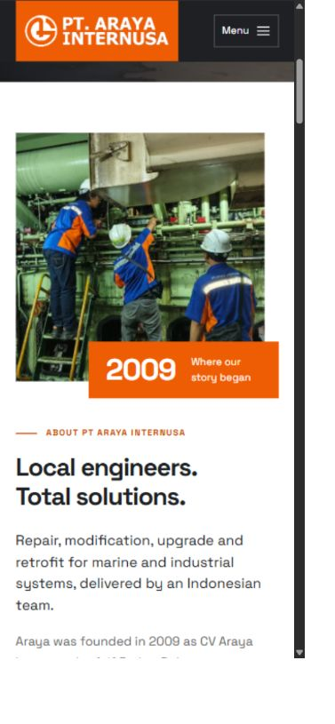
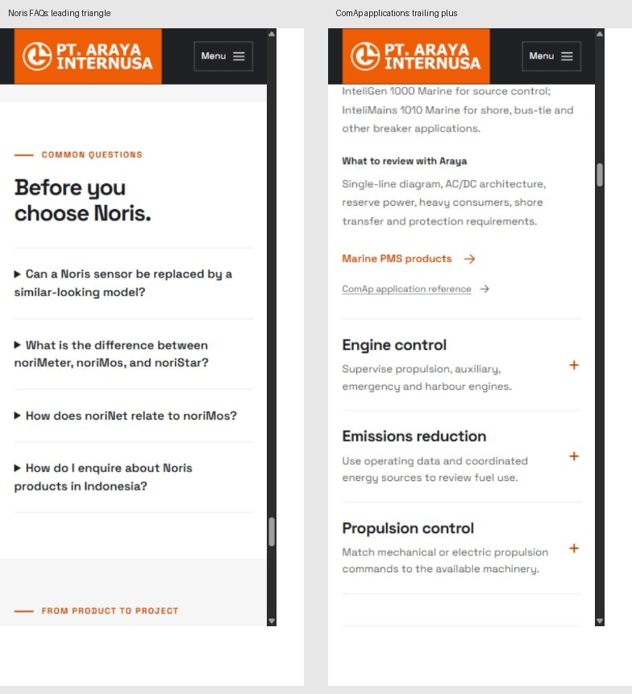
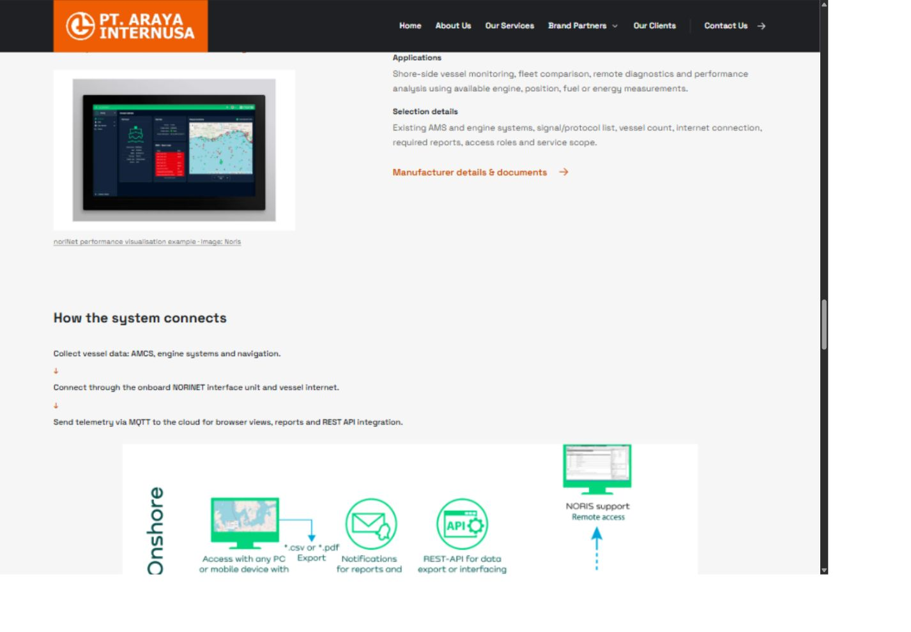
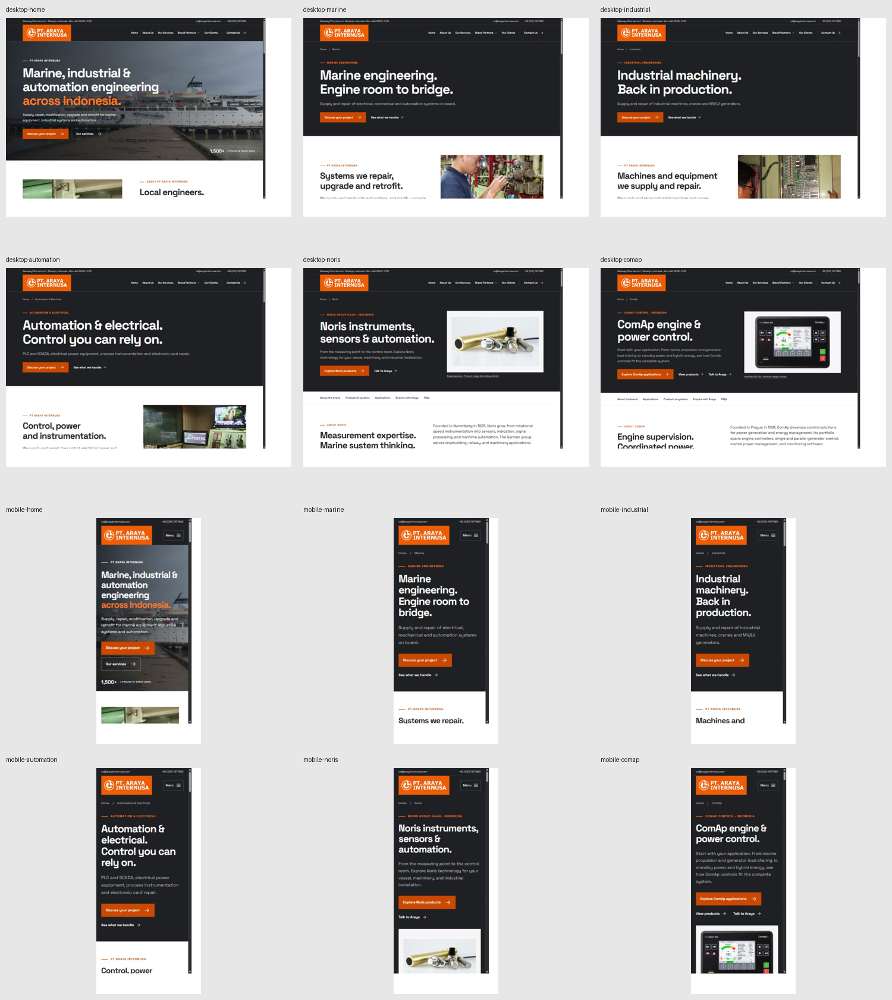

# UI consistency review — 13 October 2026

## Overall assessment

The six pages form a coherent visual system. The original logo, Space Grotesk type, orange/charcoal palette, square edges, shared navigation and main spacing rules are consistent. The useful next step is to tighten a few components within that existing style.

This is a review of local website commit `2503995aba9878e2a84658a5597267b27c629035`. It is separate from the earlier code/release review. No website source was changed or published during this audit.

## Findings, in recommended order

### 1. Medium: the small caption on the orange About badge has weaker contrast than the buttons

**Where:** homepage About section, `public/assets/site.css:6` (`.since`, `.since span`).

The 13px white “Where our story began” caption sits on `#ee5c03`, giving approximately **3.40:1** contrast. The white text on primary buttons uses the darker `#cb4800`, giving approximately **4.70:1**. The site already has an orange that works better for normal-size white text; the badge has not received the same treatment. The large “2009” number has a different contrast threshold and is not the issue identified here.

Recommendation: use the existing darker orange for this badge, or choose an appropriately contrasting caption colour. Preserve the orange badge and its layout.

### 2. Medium: expandable content has two different visual controls

**Where:** brand FAQs and ComAp applications; `public/assets/site.css:35` (`.faq-list`) and `:44` (`.application-detail`).

FAQs use a browser-native black triangle before the question. ComAp application rows use an orange plus at the right, rotated when expanded. The same open/close interaction therefore uses a different icon, location and open-state treatment.

Recommendation: share one disclosure component style, preferably a trailing orange indicator with the same placement, focus treatment and open-state convention. Keep question/application text sizes appropriate to their respective hierarchy; identical body layouts are unnecessary. Preserve native details/summary keyboard behaviour.

### 3. Low: secondary text does not follow a clear minimum-size rule

**Where:** mobile homepage hero/About and shared utility bar; `public/assets/site.css:11`.

At 390px, the project-index label is 9px, utility contacts 10px, homepage hero/About eyebrows 11px, and other section eyebrows 12px. The global body is 16px and action text is 14px. These smallest labels are noticeably harder to read than the rest of the interface.

Recommendation: define shared roles for metadata, eyebrows, captions, body and actions, and avoid normal reading text below 12px. Standardise matching section eyebrows first. Different roles can retain different sizes; this is not a recommendation to make all text identical.

### 4. Low: NORINET's system heading inherits browser/body defaults

**Where:** “How the system connects”, `public/assets/site.css:54` (`.portfolio-system h4`); the shared heading reset is at `:3`.

The H4 has a 24px font but inherits **40.8px line height**, **31.92px top/bottom margins** and normal letter spacing. Other site headings explicitly reset margins and use a tighter heading line height. Together with the portfolio grid gap, this creates a looser spacing rhythm around the NORINET explanation.

Recommendation: include H4 in the heading reset and give the component explicit spacing. Keep the generous overall page spacing; remove reliance on browser-default heading margins.

## Shared components that are consistent

| UI area | Desktop | Mobile | Result |
| --- | --- | --- | --- |
| Main font | Space Grotesk | Space Grotesk | Consistent across six routes. |
| Body type | 17px | 16px | Shared rule. |
| Main section headings | 49px at the checked wide viewport | 32px | Shared rule. |
| Section padding | 105px top/bottom | 65px top/bottom | Shared rhythm. |
| Header logo width | 224px | 184px | Same asset/treatment across pages. |
| Footer logo width | 210px | 210px | Shared footer. |
| Primary buttons | 16px text, 56px minimum height | 14px text, 52px minimum height | Same darker orange, padding rules and square edges. |
| Header/footer navigation | Shared shell | Shared shell | Consistent placement, labels and styling. |
| Reflow | No horizontal page overflow observed | No horizontal page overflow observed | All six routes checked. |

## Intentional variations to retain

- The homepage uses an image-backed hero, service pages use text-led heroes, and brand pages include product images. These serve different content and still share the same visual language.
- Wide hero titles are 71px on home, 73px on services and 64px in the split brand hero. Brand titles have less horizontal room; this is a reasonable layout variant. At 390px, home is about 37px, services 43px and brands 40px. A stricter shared scale would be optional polish, not a required correction.
- Bright logo orange, darker button/text orange and lighter orange on dark backgrounds have different contrast roles. Do not collapse them into one colour indiscriminately.
- Engineering photographs fill their frames; product images and technical diagrams use contain fit to preserve equipment and labels.
- Service rows, product detail rows and enquiry checklists can retain different layouts for their different content.

## Audit steps and evidence

1. **Header and footer — consistent.** Compared the shared shell and computed styles across home, Marine, Industrial, Automation, Noris and ComAp; inspected the shared contact area.
2. **Page layouts and actions — consistent.** Captured and inspected all six routes on desktop and mobile; compared section padding, main headings, buttons, logo sizes and reflow.
3. **Expandable content — visually inconsistent.** Captured Noris FAQs and ComAp application rows, including opening and closing the Engine control item.
4. **Typography and spacing — small polish gaps.** Compared mobile secondary labels and measured the NORINET H4's line height/margins.
5. **Colour/contrast — one confirmed caption issue.** Inspected the About badge and calculated the contrast of its actual CSS colours against the primary-button treatment.

Final validated desktop captures are 1440×1000 CSS pixels; mobile captures are 390×844. Initial wide-screen metrics were collected at 1584px before browser presentation settled; final viewport/H1/H2 checks are retained separately. The shared values in the table are unchanged at those desktop widths. The mobile homepage was recaptured after confirming 390px. An initial NORINET image-loading capture was rejected and replaced with a fully loaded capture. Browser sizing was restored after capture.

Full local captures and computed-style JSON: `arayaweb/design/ui-consistency-2026-10-13/`. The accepted images embedded here are stored with this report, outside the deployable `public/` directory.

This is a visual/component audit, not a complete accessibility certification, fresh Lighthouse test or search-ranking assessment. It does not claim to test every browser, device or assistive technology. Findings include existing UI details as well as newer components; they are not all regressions from the owner's latest changes. Source and Git history were preserved; audit documentation is left uncommitted for review.
